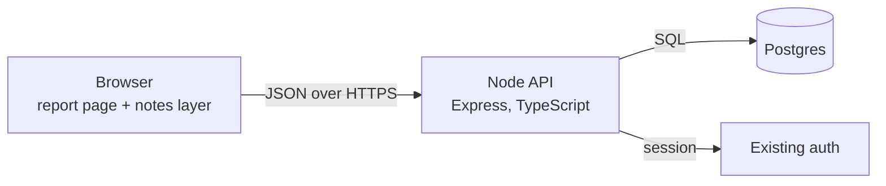
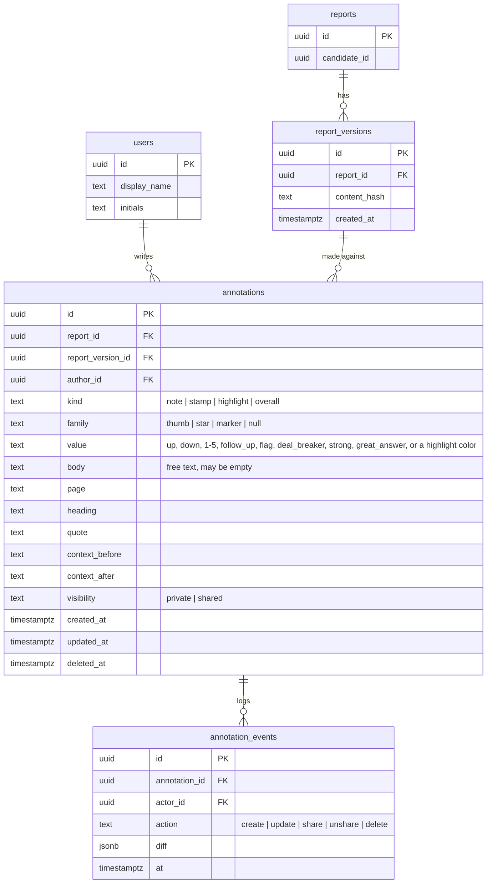
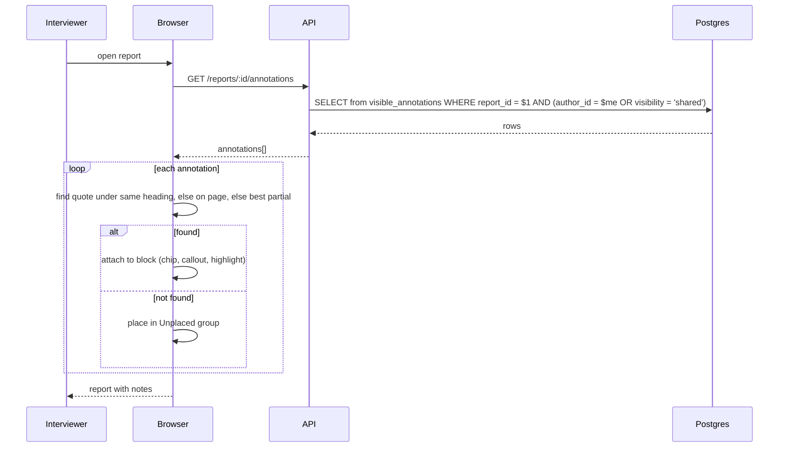

# 03 · Technical Design: Report Notes

How Report Notes is implemented inside Assessment System: a browser layer over the existing report
page, a Node API, and a Postgres schema. This document covers architecture, the data model, the
endpoints, and the anchoring rules. Requirement IDs refer to `02-requirements.md`.

## Contents

1. [Architecture](#architecture)
2. [Data model](#data-model)
3. [API](#api)
4. [Loading and re-anchoring](#loading-and-re-anchoring)
5. [Saving](#saving)
6. [Authorization](#authorization)
7. [Errors](#errors)
8. [Decisions and alternatives](#decisions-and-alternatives)

## Architecture



- **Browser.** The report renders as today. A notes layer (`notes.js`, `notes.css`) attaches to it,
  draws the rail, chips, cards, selection bar, panel, and print preview, and talks to the API. It
  keeps an in-memory list of annotations and re-renders from that list after every change.
- **Node API.** Express routes under `/api/reports/:reportId/annotations`. Validation with a schema
  library, SQL through the platform's existing query layer. No new services.
- **Postgres.** One new table plus one view. Reports, report versions, and users already exist.

## Data model



Rules carried by the schema:

- `kind`, `family`, `value`, and `visibility` are check constraints, not free text.
- One stamp per family per block per user (FR-ANN-06): a partial unique index on
  `(report_id, author_id, page, heading, quote, family) WHERE kind = 'stamp' AND deleted_at IS NULL`.
- Overall stamps use `page = 'Overall'`, `heading = 'Overall'`, and an empty `quote`, so the same
  index gives one thumb, one star, and one marker per person (FR-OVR-02).
- `deleted_at` makes deletion soft (NFR-PRV-02). `annotation_events` is the audit trail.
- A view `visible_annotations` joins users and filters `deleted_at IS NULL`.

## API

All routes require a session (NFR-SEC-01). `:reportId` must be a report the caller can open.

| Method | Path | Purpose | Req |
|---|---|---|---|
| GET | `/api/reports/:reportId/annotations` | All annotations the caller may see: their own plus shared ones | FR-PER-01, FR-SHR-03 |
| POST | `/api/reports/:reportId/annotations` | Create one annotation | FR-PER-02 |
| PATCH | `/api/annotations/:id` | Change `body`, `value`, or `visibility` on an owned annotation | FR-SHR-02, FR-ANN-10 |
| DELETE | `/api/annotations/:id` | Soft-delete an owned annotation | FR-ANN-10 |
| GET | `/api/reports/:reportId/version` | Current `report_version_id` and `content_hash` | FR-ANC-05 |

Request and response shape, shared by every route:

```json
{
  "id": "4f1c…",
  "reportId": "9ab2…",
  "reportVersionId": "77e0…",
  "author": { "id": "c0de…", "displayName": "Dana Reyes", "initials": "DR" },
  "kind": "highlight",
  "family": null,
  "value": "yellow",
  "body": "Ask about the Riverside rollout",
  "page": "Interview",
  "heading": "Organization",
  "quote": "prefers a written plan before starting",
  "contextBefore": "the candidate said she ",
  "contextAfter": " and keeps it updated",
  "visibility": "private",
  "createdAt": "2026-11-09T14:02:11Z",
  "updatedAt": "2026-11-09T14:02:11Z"
}
```

`POST` accepts everything except `id`, `author`, `createdAt`, and `updatedAt`. `PATCH` accepts only
`body`, `value`, and `visibility`; any other field is rejected with 400 (FR-SHR-04, locked fields).

## Loading and re-anchoring



Re-anchoring happens in the browser because only the browser has the rendered text (FR-ANC-03).
Matching ignores whitespace. Heading and chart-row quotes exclude numeric scores so a rescore does
not unplace a note. The server never rewrites anchors.

## Saving

```mermaid
sequenceDiagram
  participant B as Browser
  participant A as API
  participant P as Postgres
  B->>A: POST /reports/:id/annotations {kind, family, value, body, page, heading, quote, …}
  A->>A: validate shape, check caller can open report
  A->>P: INSERT annotation; INSERT annotation_event(create)
  P-->>A: row
  A-->>B: 201 annotation
  B->>B: replace optimistic entry with stored one (FR-PER-03)
```

The browser applies the change immediately and reconciles with the response. On a 4xx it reverts
and shows a toast. Stamps that replace an existing value are a `PATCH` on the existing row; stamps
that clear are a `DELETE`.

## Authorization

- Reading: the SQL predicate `author_id = $me OR visibility = 'shared'` is in the query, never applied
  afterwards in code (NFR-SEC-02).
- Writing: `PATCH` and `DELETE` include `AND author_id = $me` in the `UPDATE`; zero rows affected
  returns 403 with no hint whether the row exists (FR-SHR-04).
- Report access: the existing report permission check runs before any annotation query.

## Errors

| Status | When |
|---|---|
| 400 | Invalid shape, unknown `kind`/`family`/`value`, `PATCH` touching a locked field |
| 401 | No session |
| 403 | Caller cannot open the report, or does not own the annotation |
| 404 | Report not found |
| 409 | Duplicate stamp for the same family and block (unique index) |

## Decisions and alternatives

| Decision | Alternative considered | Why not |
|---|---|---|
| One `annotations` table with `kind` | A table per kind | Four near-identical tables; the panel and export want one list |
| Re-anchor in the browser | Store DOM paths server side | Paths break on every report regeneration; text does not |
| Soft delete plus events table | Hard delete | Audit and undo need the row |
| Visibility as a column | A join table of grantees | Only two states are required; a grantee table can replace the column later without changing the API |
